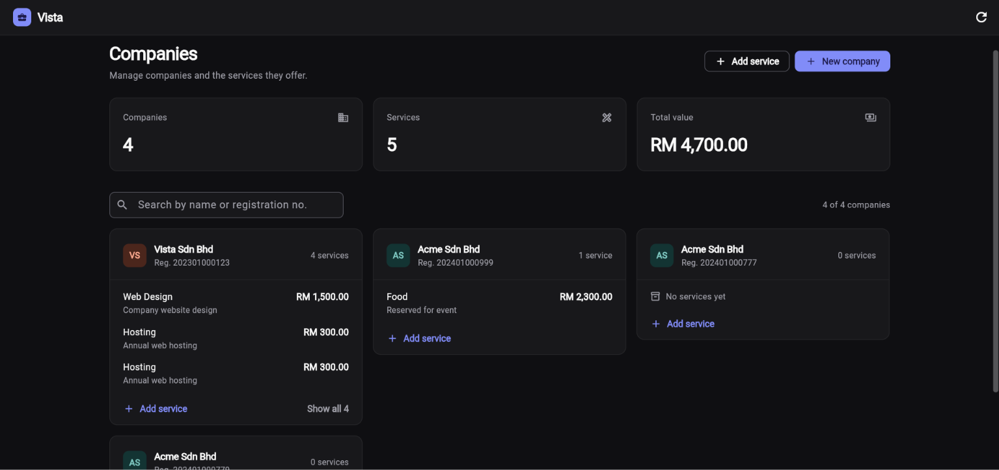

# Vista Technical Test – Flutter Frontend

Flutter app for managing companies and their services, connected to the
[Vista backend API](https://github.com/YaruJanne/back-end-test-vista).



**Tech stack:** Flutter, Dart, `http` (API calls), `provider` (state management)

## Features

- **Company list:** all companies with registration number and their services (name, description, price)
- **Create company:** form with validation (name and registration number required)
- **Create service:** form with company dropdown, validation (required fields, numeric price)
- **Minimal, modern UI:** neutral surfaces, hairline borders, one accent color, consistent 8px controls
- **Summary stats:** total companies, services and combined service value
- **Search:** filter companies by name or registration number
- Company cards with initials avatar, service count, hover effect and "Show all" for long service lists
- Loading states, error messages with retry, pull-to-refresh
- API errors (e.g. duplicate registration number) shown to the user
- Responsive layout: 1, 2 or 3 columns depending on screen width; forms centered on wide screens
- Light and dark mode (follows the system setting)

## Requirements

- Flutter SDK 3.50+ (Dart 3.14+)
- The backend API running (see the backend README)

## Setup & Run

```bash
git clone https://github.com/YaruJanne/front-end-test-vista.git
cd front-end-test-vista
flutter pub get
```

Start the backend first (default `http://localhost:3000`), then:

| Target | Command | API address used |
|---|---|---|
| Chrome (web) | `flutter run -d chrome` | `http://localhost:3000` |
| Android emulator | `flutter run` | `http://10.0.2.2:3000` (emulator's alias for your PC) |
| Real device / custom URL | `flutter run --dart-define=API_BASE_URL=http://192.168.x.x:3000` | Your value |

The base URL logic lives in `lib/config/api_config.dart`.

## Tests

```bash
flutter test
```

## Project Structure

```
lib/
├── main.dart                     # App entry, Provider setup, light/dark theme
├── theme/app_theme.dart          # Light/dark color palettes and button styles
├── config/api_config.dart        # API base URL per platform
├── models/                       # Company, Service (fromJson)
├── services/
│   ├── api_service.dart          # All HTTP calls + error handling
│   └── api_exception.dart        # Readable API error type
├── providers/company_provider.dart  # State: companies, loading, error
├── screens/
│   ├── company_list_screen.dart
│   ├── create_company_screen.dart
│   └── create_service_screen.dart
├── widgets/
│   ├── top_bar.dart              # App bar with brand / page title
│   ├── summary_header.dart       # Stat cards (companies, services, total value)
│   ├── company_card.dart         # Company card with services (expandable)
│   ├── company_avatar.dart       # Colored initials avatar
│   ├── message_view.dart         # Empty / error / no-results states
│   ├── app_input.dart            # Shared input field style
│   └── form_container.dart       # Responsive form layout + Cancel/Submit actions
└── utils/format.dart             # Price formatting (RM 1,500.00)
```

## State Management

`CompanyProvider` (a `ChangeNotifier`) holds the company list, loading flag and error message.
Screens read it with `context.watch` and call `addCompany` / `addService`, which
call the API and then refresh the list.

Purely visual state stays local to the widget that owns it: form submission (`_isSubmitting`)
in each form screen, the search query in the list screen, and the expanded/collapsed state in each card.
